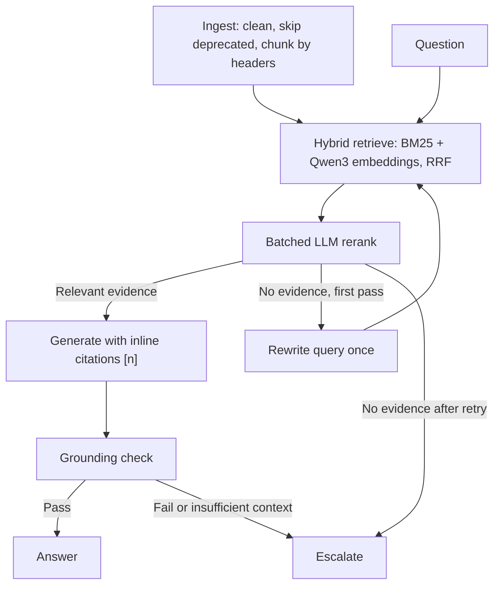

# DBA Assistant

DBA Assistant helps on-call DBAs and application engineers answer database incident, runbook, and policy questions from the Northwind DBA knowledge base.

- Gives answers with inline `[n]` citations and inspectable source excerpts.
- Combines keyword and semantic search with hybrid retrieval and LLM reranking.
- Escalates to on-call instead of guessing when evidence is insufficient or ungrounded.

## Architecture



**Ingest.** Parse front matter, remove HTML/export artifacts, and skip deprecated documents. Split at `##` headers, then into 1,000-character chunks with 150-character overlap and title/section prefixes. The 25-document synthetic corpus yields 24 indexed documents and 101 chunks; re-ingest after document changes.

**Hybrid retrieve.** Search BM25 and local NumPy vectors using Qwen3 query embeddings. Reciprocal Rank Fusion (RRF) merges the top 20 results from each mode into eight candidates.

**Batched rerank.** The fast LLM grades candidates in one call and keeps up to four relevant chunks. If none qualify, rewrite the query and retry retrieval once, then escalate if evidence is still missing.

**Generate.** The main LLM answers from selected sources with inline `[n]` citations. It is instructed to surface conflicting sources rather than silently choose one.

**Grounding check.** The fast LLM checks the answer against its sources; code also validates citation presence and range. Unsupported answers and insufficient-context responses escalate.

**Answer or escalate.** Streamlit shows confidence, source excerpts, retrieval traces, and warnings for cited documents last reviewed over 180 days ago. Escalation provides contact instructions for `#dba-help` or PagerDuty `DBA-Primary` and a draft handoff note; it does not send a page automatically.

## RAG framework

From [PLAN.md](PLAN.md):

| Field | Decision |
|---|---|
| Use case | On-call DBAs / app engineers ask "how do I fix X / what's the policy for Y" in a chat UI |
| Corpus | 25 synthetic markdown docs for fictional Northwind Data: runbooks, policies, postmortems, error-code reference, FAQ (data/corpus) |
| Ingestion + cleaning | Parse front-matter; html.unescape; strip HTML comments/tags and confidential footer; skip status: deprecated |
| Freshness | Re-ingest on every docs change; docs with last_reviewed > 180 days flagged stale and warned in answers |
| Chunking + embedding | Split on ## headers, then 1000 chars / 150 overlap; "[title > section]" prefix; Qwen/Qwen3-Embedding-8B (4096-dim) |
| Retrieve | Local NumPy vector store + BM25; hybrid via Reciprocal Rank Fusion (top 20 each, k=8); LLM batch rerank keeps top 4 |

## Tech stack

- **uv** for dependencies and commands; **LangChain** for model/retriever integration; **LangGraph** for orchestration.
- **Nebius Token Factory:** Qwen3-Embedding-8B for embeddings, Qwen3-235B-A22B-Instruct-2507 for answers/evaluation, and Qwen3-30B-A3B-Instruct-2507 for grading, rewriting, and grounding checks.
- **LangSmith** for tracing; **Streamlit** for the chat UI.

## Setup

```bash
uv sync
cp .env.example .env
```

Fill in `NEBIUS_API_KEY`, `EMBED_MODEL`, `LLM_MODEL`, and `FAST_LLM_MODEL`. For tracing, set `LANGSMITH_API_KEY` and `LANGSMITH_TRACING=true`; choose a `LANGSMITH_PROJECT`.

```bash
uv run python check_setup.py
uv run python -m rag.ingest
```

The setup check lists provider model IDs; if needed, update `.env` with those IDs and rerun it before ingesting.

## Run

```bash
# Chat UI
uv run streamlit run app.py

# CLI
uv run python cli.py "What does SQLSTATE 40P01 mean?"

# Evaluation (replace <name> with a run tag)
uv run python eval/run_eval.py --tag <name>

# Tests
uv run python -m unittest discover -s tests -v
```

## Evaluation

The benchmark has **20 questions**: 9 single-doc, 4 multi-doc, 1 conflict, 1 ambiguous, and 5 should-escalate cases, including a general-knowledge trap (PostgreSQL's default `max_connections`, absent from the corpus).

Results from the [baseline report](eval/results/report_baseline.md) and [iteration 1 report](eval/results/report_iteration1.md):

| Metric | Baseline | Iteration 1 |
|---|---:|---:|
| p50 latency | 10.85 s | 7.34 s |
| p95 latency | 21.91 s | 12.51 s |
| Faithfulness | 93.3% | 93.3% |
| Resolution rate | 100.0% | 100.0% |
| Correct escalation rate | 100.0% | 100.0% |
| Citation accuracy | 100.0% | 91.7% |

| Retrieval MRR@5 | Baseline | Iteration 1 |
|---|---:|---:|
| BM25 | 0.93 | 0.93 |
| Dense | 0.92 | 0.92 |
| Hybrid | 1.00 | 1.00 |

Retrieval is scored on 14 questions with expected documents; all modes achieved 100% hit@5. MRR measures the first relevant chunk, not complete multi-document coverage. Faithfulness is LLM-judged on non-escalated answers; citation accuracy measures cited-document overlap with expected documents. Resolution and faithfulness are separate metrics. Latency excludes the separate evaluation judge.

**What changed in iteration 1**

- Reuse the retriever and API clients as process-wide singletons.
- Cap output tokens for generation, grading, rewriting, and grounding checks.
- Surface conflicting sources instead of picking one.

Latency improved, but citation accuracy fell and faithfulness stayed flat; the reports retain per-question failures for review.

## Known limitations

- Synthetic corpus and a small benchmark limit generalization to production incidents.
- LLM-judge variance makes faithfulness scores indicative rather than definitive.
- p95 remains above the 10-second target, mainly due to the remote embedding API.
- Substring-based key-fact scoring can miss correct paraphrases.

## Next steps

- Move vector storage to **pgvector in PostgreSQL**.
- Use local embeddings or extend the existing in-process query cache with persistent caching.
- Track evaluations with **LangSmith datasets and experiments**.
- Add a **Slack bot** for DBA questions and handoffs.

## How I used AI coding tools

I scoped the use case, designed the architecture and evaluation, and wrote step-by-step prompts. Codex implemented each step. I ran, tested, and debugged the system—including disabled LangSmith tracing, missing trace inputs, and bloated rewrite queries—and chose the iteration from evaluation results.
